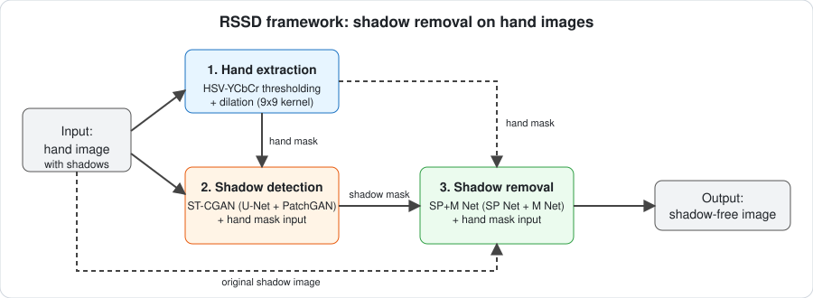
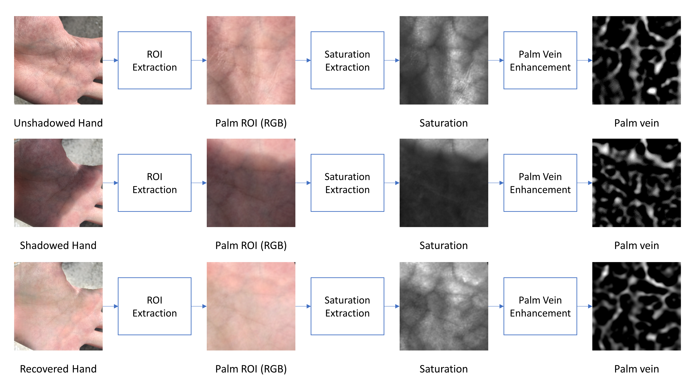
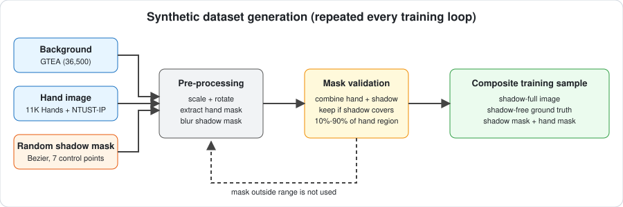
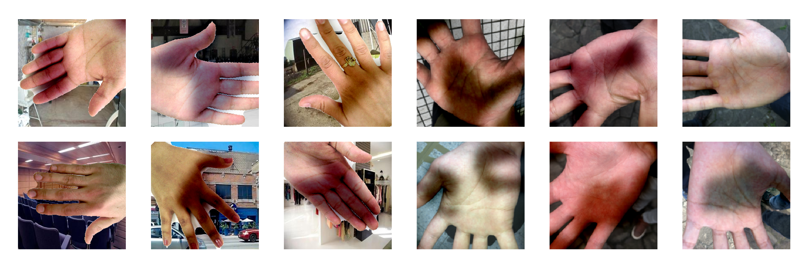
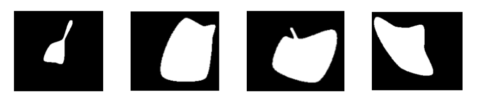
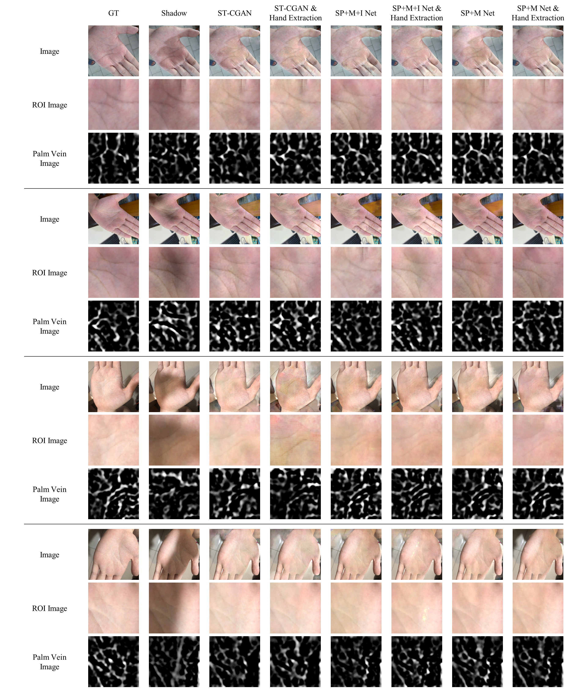

# RSSD: Removing Shadow using Synthetic Dataset

Code for **shadow detection and removal on hand images**, built to improve contactless palm vein recognition.

> **Paper:** Shi-Jinn Horng, Minh-Tuong Le, Thi-Van Nguyen, Dinh-Trung Vu. *"Shadow Detection and Removal from Hand Images using Synthetic Dataset."* PRIP'2023. [[Paper page]](https://elib.bsu.by/handle/123456789/306240) · [[PDF]](https://elib.bsu.by/bitstream/123456789/306240/1/29-34.pdf)

---

## Overview

Contactless hand-based biometrics, such as palm vein recognition, are increasingly used for authentication. In real-world conditions, shadows cast on the hand disrupt the vein structure and cause recognition errors. This project removes those shadows to recover the palm vein pattern.

The framework takes a hand image with shadows as input and outputs a shadow-free image. It has three stages:

1. **Hand extraction.** Skin segmentation using HSV-YCbCr thresholding produces a hand mask.
2. **Shadow detection.** ST-CGAN, modified to take the hand mask as an extra input, predicts a binary shadow mask.
3. **Shadow removal.** SP+M Net (also tested: SP+M+I Net and the ST-CGAN removal branch), likewise modified to take the hand mask, produces the shadow-free image.

<p align="center">
  
</p>

### Key contributions

- **Shadow removal tailored to hands.** Shadow detection and removal models are evaluated for hands, with a hand extraction module added to each.
- **Synthetic dataset regenerated every training iteration.** Instead of a fixed set of (shadow image, shadow-free image, mask) triplets, a new synthetic dataset is composed in each training loop.
- **Random shadow mask generator.** Shadow masks come from a Bézier-curve-based random shape generator (7 randomly placed control points), so masks change every iteration.
- **NTUST-HS test set.** 1,600 contactless RGB palm images affected by shadows (800 outdoor, 800 indoor) for evaluating shadow effects on palm ROI and vein images.

## Method details

<p align="center">
  <br>
  <em>Shadows disrupt palm vein structure; removing them recovers it (paper, Fig. 1).</em>
</p>

### Hand extraction

Skin detection uses the HSV-YCbCr thresholding rule:

```
(0 ≤ H ≤ 5) ∧ (0.23 ≤ S ≤ 0.68) ∧ (85 ≤ Cb ≤ 135) ∧ (135 ≤ Cr ≤ 180)
```

Two changes were made to the original method: the kernel size was increased from (5,5) to (9,9), and the final morphological opening was replaced with dilation.

### Shadow detection (ST-CGAN + hand mask)

- U-Net generators with increased depth, so that convolutions reach a minimum size of 1×1.
- PatchGAN discriminator.
- The hand mask is added as an extra input.

### Shadow removal (SP+M Net + hand mask)

SP Net estimates the parameters of a linear illumination model to relight the shadow region. M Net predicts a shadow matte. The final shadow-free image combines the relit image, the matte, the shadow mask, and the input image. The hand mask is an extra input.

### Synthetic data generation (per training loop)

| Component | Source |
|---|---|
| Backgrounds | GTEA dataset (36,500 images) |
| Hands | 11K Hands database (11,076 images) + NTUST-IP (11,220 images) |
| Shadow masks | Random Bézier shape generator |

Each loop: load data, scale and rotate, extract the hand mask, blur the random shadow mask, combine it with the hand mask, then keep it only if shadow pixels cover **10%–90%** of the hand region. The validated mask is applied to the background composite to make the shadow image. One epoch yields 22,296 synthetic samples, which is the combined hand image count.

<p align="center">
  
</p>

<p align="center">
  <br>
  <em>Samples from the synthetic dataset (paper, Fig. 6).</em>
</p>

<p align="center">
  <br>
  <em>Random shadow masks from the Bezier shape generator (paper, Fig. 8).</em>
</p>

## Results

PSNR and SSIM, where higher is better. "HE" means the hand extraction module is used.

**Synthetic test set**

| Method | PSNR | SSIM |
|---|---|---|
| Input shadow image | 12.6877 | 0.7768 |
| ST-CGAN | 25.0984 | 0.9158 |
| ST-CGAN + HE | 25.1892 | 0.9170 |
| SP+M+I Net | 21.7376 | 0.8948 |
| SP+M+I Net + HE | 21.7464 | 0.8954 |
| SP+M Net | 25.3956 | 0.9259 |
| **SP+M Net + HE** | **25.3997** | **0.9261** |

**NTUST-HS, palm ROI images (color), all scenes**

| Method | PSNR | SSIM |
|---|---|---|
| Input shadow image | 15.949 | 0.7601 |
| ST-CGAN | 19.440 | 0.7840 |
| ST-CGAN + HE | 19.671 | 0.7915 |
| SP+M+I Net | 19.560 | 0.7901 |
| SP+M+I Net + HE | 19.885 | 0.7952 |
| SP+M Net | 19.649 | 0.7947 |
| **SP+M Net + HE** | **19.932** | **0.7977** |

**NTUST-HS, palm vein images (one channel), all scenes**

| Method | Dice | SSIM |
|---|---|---|
| Input shadow image | 0.1809 | 0.2856 |
| ST-CGAN | 0.1790 | 0.2737 |
| ST-CGAN + HE | 0.1762 | 0.2737 |
| SP+M+I Net | 0.1814 | 0.2817 |
| SP+M+I Net + HE | 0.1819 | 0.2826 |
| SP+M Net | 0.1847 | 0.2887 |
| **SP+M Net + HE** | **0.1866** | **0.2914** |

The paper's main findings:

- Adding hand extraction improves results in most settings.
- SP+M Net with hand extraction performs best overall.
- Outdoor shadows are harder to handle than indoor ones.
- The models can fail on complex shadow patterns or extremely dark shadows. The authors plan to increase the diversity of shadow masks in color and shape.

Per-scenario (indoor/outdoor) numbers are in Table II of the paper.

<p align="center">
  <br>
  <em>Shadow removal on hands: different people, indoor and outdoor scenes, left and right hands (paper, Fig. 10).</em>
</p>

## Repository structure

```
.
├── assets/                       # README images
├── source/                       # Training and testing code
│   ├── train.sh
│   └── test.sh
├── Extract_Vein_By_Trung/        # Palm ROI / vein extraction tool (Windows, .NET 6)
├── compute_score.ipynb           # Score computation notebook
├── get_score.sh                  # Score computation script
└── README.md
```

## Getting started

### Prerequisites

Place the following inside `source/`:

- `database/`: the datasets (backgrounds, hand images, and test data)
- `checkpoint/`: pretrained weights, optional, only if you want to skip training

The paper's experiments were run on NVIDIA GeForce RTX 2080 Ti (11 GB) GPUs.

### Usage

```bash
# 1. Train
bash source/train.sh

# 2. Test / generate shadow-free outputs
bash source/test.sh

# 3. Compute scores
bash get_score.sh
```

Scores can also be explored interactively in `compute_score.ipynb`.

For the vein-image evaluation, palm ROI and vein images are extracted with the method from Horng et al., *Recognizing Palm Vein in Smartphones Using RGB Images* (IEEE TII, 2022).

## Datasets

| Dataset | Use | Link |
|---|---|---|
| GTEA | Background images | https://cbs.ic.gatech.edu/fpv/ |
| 11K Hands | Hand images | https://sites.google.com/view/11khands |
| NTUST-IP | Hand images (collected by the authors) | n/a |
| NTUST-HS | Real shadowed palm test set (1,600 images) | n/a |

## Citation

If you use this code or paper, please cite:

```bibtex
@inproceedings{horng2023shadow,
  title     = {Shadow Detection and Removal from Hand Images using Synthetic Dataset},
  author    = {Horng, Shi-Jinn and Le, Minh-Tuong and Nguyen, Thi-Van and Vu, Dinh-Trung},
  booktitle = {Pattern Recognition and Information Processing (PRIP)},
  year      = {2023},
  url       = {https://elib.bsu.by/handle/123456789/306240}
}
```

## Acknowledgements

This work builds on [ST-CGAN](https://arxiv.org/abs/1712.02478) (Wang et al., CVPR 2018) and SP+M Net / SP+M+I Net (Le & Samaras, ICCV 2019 / TPAMI 2021). Please also cite those works where appropriate.